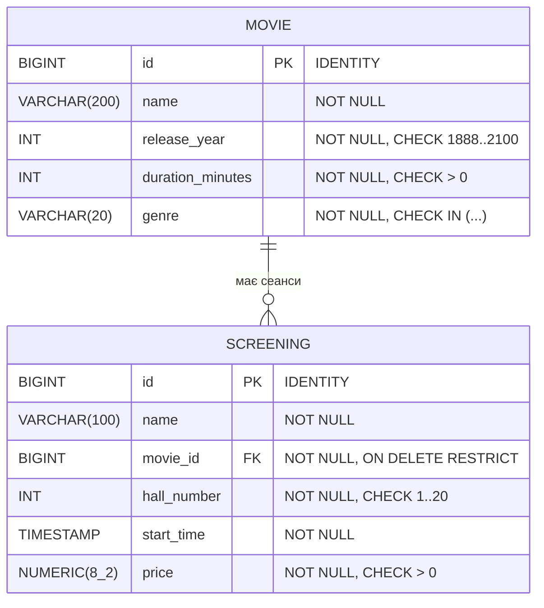

# Cinema-salesperson-s-workplace

Предметна область: **робоче місце касира кінотеатру**.

## Лабораторна робота №10 — Maven і робота з реляційною БД через JDBC

У ЛР №7 були інтерфейси `CRUDService<T>`, `MovieService` і їх реалізація на колекціях. Тут — **друга реалізація тих самих інтерфейсів**, яка зберігає дані в БД. Клієнтський код `ServiceDemo` не змінюється: `App` запускає його спершу з `InMemoryMovieService`, потім з `JdbcMovieService` — вивід однаковий.

### Сутності
| Клас | Таблиця | Поля |
|------|---------|------|
| `Movie` (фільм) | `movie` | `id`, `name` (назва), `release_year`, `duration_minutes`, `genre` |
| `Screening` (сеанс) | `screening` | `id`, `name` («Ранковий», «Вечірній»), `movie_id` → `movie.id`, `hall_number`, `start_time`, `price` |

Один фільм має багато сеансів (**один до багатьох**).

### Схема БД

| Обмеження | Навіщо |
|-----------|--------|
| `PRIMARY KEY` (сурогатний `BIGINT IDENTITY`) | у фільму немає надійного природного ключа: назви повторюються (ремейки) і можуть виправлятися |
| `UNIQUE (name, release_year)` | той самий фільм не можна внести двічі, а ремейк з іншим роком — можна |
| `UNIQUE (hall_number, start_time)` | у залі в один час може йти лише один сеанс |
| `CHECK (price > 0)`, `CHECK (duration_minutes > 0)`, `CHECK (genre IN ...)` | правила предметної області перевіряє сама БД, навіть якщо дані прийдуть не з нашої програми |
| `NUMERIC(8,2)` для ціни | гроші точно, без похибки двійкового `DOUBLE` (`0.1 + 0.2 != 0.3`); у Java — `BigDecimal` (`getBigDecimal/setBigDecimal`) |
| `FOREIGN KEY ... ON DELETE RESTRICT` | див. нижче |
| індекс `idx_screening_movie` | `findByMovieId` і перевірка FK при видаленні фільму без повного сканування `screening` |

**Чому `ON DELETE RESTRICT`.** На сеанс уже можуть бути продані квитки. `CASCADE` при видаленні фільму мовчки знищив би весь розклад, `SET NULL` неможливий (сеанс без фільму не має сенсу, `movie_id NOT NULL`). `RESTRICT` змушує спершу явно скасувати сеанси — демо, розділ C.

### Запуск з нуля
Потрібна лише **JDK 25+**. Maven ставити не обов'язково — у проєкті є Maven Wrapper (`mvnw`), він сам завантажить Maven 3.9.9. СУБД — **H2 у файловому режимі**: окремо встановлювати не треба, файл `data/cinema.mv.db` створиться при першому запуску, а `init.sql` створить таблиці.
```bash
cd lr10
./mvnw compile exec:java
```
Windows (cmd/PowerShell): `mvnw.cmd compile exec:java`. Якщо кирилиця в консолі ламається — виконайте `chcp 65001`.

Інші команди:
```bash
./mvnw exec:java -Dexec.args="reset"   # видалити всі таблиці й створити заново
./mvnw package                          # зібрати target/cinema-jdbc-1.0-SNAPSHOT.jar
./mvnw dependency:tree                  # дерево залежностей
```
**Налаштування підключення** — `src/main/resources/application.properties` (`db.url`, `db.user`, `db.password`, `db.pool.size`). Кожен параметр можна перекрити змінною оточення `DB_URL`, `DB_USER`, `DB_PASSWORD`, `DB_POOL_SIZE` — так реальний пароль не потрапляє в git. Для PostgreSQL достатньо додати його драйвер у `pom.xml` і задати `DB_URL=jdbc:postgresql://localhost:5432/cinema`.

### Структура
```
lr10/
├── pom.xml                         groupId ua.polytech.cinema, artifactId cinema-jdbc
├── mvnw, mvnw.cmd, .mvn/           Maven Wrapper, UTF-8 для консолі
└── src/main/
    ├── resources/
    │   ├── application.properties  параметри БД
    │   └── init.sql                DDL, виконується при старті
    └── java/ua/cinema/
        ├── App.java                точка входу
        ├── ServiceDemo.java        клієнтський код (знає лише інтерфейси)
        ├── model/                  BaseEntity, Movie, Screening, Genre
        ├── service/                CRUDService, MovieService, ScreeningService, EntityNotFoundException, ...
        ├── memory/                 реалізація з ЛР №7 (LinkedHashMap)
        └── jdbc/                   DBConnection, DbInitializer, AbstractJdbcCrudService,
                                    JdbcMovieService, JdbcScreeningService, ScheduleService
```

### Де що реалізовано
| Вимога | Де |
|--------|----|
| Maven-структура, GAV, `maven.compiler.release`, UTF-8 | `pom.xml` |
| JDBC-драйвер (H2, scope `runtime`) | `pom.xml` |
| `init.sql`: PK, NOT NULL, NUMERIC, UNIQUE, CHECK, FK | `src/main/resources/init.sql` |
| Singleton `DBConnection`, параметри у properties | `jdbc/DBConnection.java` |
| `JdbcMovieService implements MovieService`: `findById/save/delete/findAllSortedByName` | `jdbc/JdbcMovieService.java` + `AbstractJdbcCrudService` |
| Лише `PreparedStatement` + try-with-resources | усі сервіси (виняток — `DbInitializer`, див. коментар) |
| `EntityNotFoundException` | `findById`, `save` (оновлення неіснуючого id) |
| Друга таблиця, FK, `ON DELETE` | `screening`, демо C |
| `findAllSortedByNameAndBy...()` через `ORDER BY` | `JdbcMovieService`, `JdbcScreeningService` |
| `mapRow` | у кожному сервісі, викликається з одного `query(...)` |
| Автозапуск `init.sql`, ідемпотентність | `DbInitializer.run` у `App.main` |
| Транзакція над двома таблицями, rollback | `ScheduleService.addMovieWithScreenings`, демо A, B |
| SQL-ін'єкція | цей README + демо D |
| Template Method `AbstractJdbcCrudService<T>` | `jdbc/AbstractJdbcCrudService.java` |
| Пул з'єднань HikariCP у Singleton | `DBConnection` |
| `addBatch/executeBatch` + вимірювання | `saveAll`, демо F |
| Пагінація `LIMIT/OFFSET` | `findPage`, демо E |

---

## Пояснення

### Що змінилося в клієнтському коді при переході на JDBC
Нічого. `ServiceDemo.run(MovieService, ScreeningService)` викликається двічі з різними реалізаціями (`App.main`). Це **принцип інверсії залежностей / програмування на інтерфейс** (і принцип підстановки Лісков): клієнт залежить від абстракції `MovieService`, а не від способу зберігання. Якби `JdbcMovieService` мав інші методи, довелося б переписувати кожне місце використання.

Що довелося змінити в моделі: у ЛР №7 id задавав викликаючий код; тепер його генерує БД (`IDENTITY`), тож `id == 0` означає «ще не збережено», а `assignId` дозволяє призначити id **один раз** (далі він знову незмінний). `hashCode` більше не залежить від id — інакше об'єкт «загубився» б у `HashSet` після збереження. Реалізація в пам'яті генерує id так само (лічильник `AtomicLong`), тому поведінка однакова.

### `save`: додавання чи оновлення
`id == 0` → `INSERT` з `Statement.RETURN_GENERATED_KEYS`, згенерований ключ з `getGeneratedKeys()` призначається об'єкту (інакше програма не знала б, під яким id запис лежить у БД). `id != 0` → `UPDATE ... WHERE id = ?`; якщо `executeUpdate()` повернув 0 рядків — такого запису немає, кидається `EntityNotFoundException`. `save(null)` → `NullPointerException` з повідомленням.

### Template Method — `AbstractJdbcCrudService<T>`
Каркас (`findById`, `save`, `delete`, `findAll`, `findPage`, `saveAll`, спільний цикл `query(...)` з `while (rs.next()) mapRow(rs)`) написано один раз. Підкласи `JdbcMovieService` і `JdbcScreeningService` перевизначають лише «кроки»: `selectSql()`, `insertSql()`, `updateSql()`, `deleteSql()`, `mapRow(ResultSet)`, `setParameters(PreparedStatement, T)`. `JdbcScreeningService` — 90 рядків, з них жодного циклу чи `try`.

### SQL-ін'єкція: Statement vs PreparedStatement
**Поганий метод** (у коді його немає, лише тут):
```java
// НЕБЕЗПЕЧНО: значення вклеюється в текст SQL
public List<Movie> findByNameUnsafe(String name) throws SQLException {
    String sql = "SELECT * FROM movie WHERE name = '" + name + "'";
    try (Connection c = ds.getConnection(); Statement st = c.createStatement();
         ResultSet rs = st.executeQuery(sql)) { ... }
}
```
Касир вводить у пошук `' OR '1'='1`. Текст запиту стає
```sql
SELECT * FROM movie WHERE name = '' OR '1'='1'
```
умова завжди істинна — повертаються **всі** фільми. З `'; DROP TABLE screening; --` (якщо драйвер дозволяє кілька інструкцій) можна знищити таблицю.

**Хороший метод** (`JdbcMovieService.findByName`):
```java
query(SELECT + " WHERE name = ?", ps -> ps.setString(1, name));
```
Текст SQL компілюється БД **до** підстановки значення; параметр передається окремо і завжди є лише даними. Той самий рядок `' OR '1'='1` шукається як буквальна назва фільму → 0 записів (демо D). Ручне екранування лапок недостатнє: легко забути одне місце, є інші спецсимволи й кодування (`\'`, багатобайтові символи), а для чисел лапок взагалі немає (`WHERE id = 1 OR 1=1`).

Через `?` не можна параметризувати назву таблиці, колонки чи `ASC/DESC` — лише значення. Тому в сервісах імена таблиць і `ORDER BY` — константи коду; якби поле сортування обирав користувач, його треба перевіряти за білим списком (`switch` / `Map<String, String>` дозволених колонок).

### Транзакція: «додати фільм разом із розкладом»
`ScheduleService.addMovieWithScreenings` вставляє рядок у `movie` і кілька в `screening` на **одному** з'єднанні:
```java
c.setAutoCommit(false);
try { insert movie; insert screenings...; c.commit(); }
catch (SQLException | RuntimeException e) { c.rollback(); throw e; }
finally { c.setAutoCommit(true); }
```
У демо B другий сеанс «Барбі» потрапляє в зал 4 на 20:00, який уже зайнятий «Оппенгеймером» → порушення `UNIQUE(hall_number, start_time)` → `rollback()`. Фільм «Барбі», вставлений першим кроком, теж зникає: кількість фільмів до й після однакова, а об'єкт `barbie` так і не отримав id (ключі призначаються лише після `commit`). ACID: **A**tomicity — усе або нічого; **C**onsistency — не буває фільму з половиною розкладу; **I**solation — інші з'єднання не бачать незакомічений фільм; **D**urability — після `commit` дані у файлі БД. Без `rollback` з'єднання повернулося б у пул з відкритою транзакцією, і наступний клієнт міг би закомітити чужі «напівзміни».

### Singleton з одним Connection — у чому проблема
| Сценарій | Що станеться з одним спільним `Connection` |
|----------|---------------------------------------------|
| Кілька потоків | `Connection` не потокобезпечний: запити перемішуються, `ResultSet` одного потоку закривається іншим |
| Транзакції різних клієнтів | `setAutoCommit(false)` / `commit()` — стан з'єднання; клієнт А закомітить або відкотить зміни клієнта Б |
| Обрив зв'язку / таймаут БД | єдине з'єднання «вмирає», і весь застосунок падає до перезапуску |
| `try-with-resources` | закрити спільне з'єднання не можна, тож ресурси керуються вручну |

**Рішення** — Singleton тримає не `Connection`, а `DataSource` з **пулом HikariCP**. Кожна операція бере своє з'єднання (`getConnection()`) і закриває його — фізично воно повертається в пул, а не закривається, тому це дешево. Пул сам перевіряє «живість» з'єднань і створює нові замість розірваних. Потокобезпечність створення Singleton — ідіома *Initialization-on-demand holder* (вкладений клас `Holder`, JVM ініціалізує його рівно один раз). Недоліки Singleton (глобальний стан, прихована залежність) пом'якшено: сервіси отримують `DataSource` через конструктор, а не викликають `DBConnection.getInstance()` всередині — у тестах можна підставити інший `DataSource`.

### Пакетна вставка (`addBatch` / `executeBatch`)
`saveAll` додає всі рядки в один `PreparedStatement` (`addBatch`), відправляє їх одним `executeBatch` і робить один `commit`. При вставці по одному кожен `save` — окремий мережевий виклик (тут — виклик рушія H2), окремий `commit` з записом на диск і отримання з'єднання з пулу.

Результат вимірювання (демо F, H2 файловий режим, 2000 рядків, ноутбук автора):

| Спосіб | Час |
|--------|-----|
| по одному (`save` × 2000, autocommit) | 115–150 мс |
| пакетом (`saveAll`, один `executeBatch`, один commit) | 20–30 мс |

Пакетна вставка **≈ 5 разів швидша**. Для мережевої СУБД (PostgreSQL) різниця ще більша, бо кожен запит по одному — це мережевий round-trip.

### Пагінація і небезпека `findAll()`
`findPage(page, size)` → `... ORDER BY id LIMIT ? OFFSET ?`. `findAll()` на таблиці з мільйонами рядків завантажить усе в пам'ять (`OutOfMemoryError`), довго передаватиме дані мережею й тримає з'єднання. Обмеження `OFFSET`: БД все одно проходить і відкидає перші `offset` рядків, тому далекі сторінки повільні; при вставках/видаленнях між запитами рядки «з'їжджають» між сторінками. Альтернатива — keyset-пагінація: `WHERE id > :lastId ORDER BY id LIMIT ?`. Без `ORDER BY` порядок рядків **не гарантований**, і сторінки можуть перетинатися.

### Сортування в БД vs у Java
`findAllSortedByNameAndByReleaseYear()` — `ORDER BY name, release_year`: БД може використати індекс, а клієнт отримує вже готовий порядок і не тримає всі записи в пам'яті (особливо разом з `LIMIT`). Різниця помітна на великих таблицях. Щоб порядок у БД збігався з `Collator` з ЛР №7 («Їжачок» після «Дюна», а не на початку, як при бінарному порівнянні кодів Unicode), у URL задано `COLLATION=UKRAINIAN STRENGTH SECONDARY`. Довільний `Comparator` (`findAllSorted`) БД не знає — він виконується в Java.

### Maven
- **GAV проєкту**: `ua.polytech.cinema:cinema-jdbc:1.0-SNAPSHOT`. Драйвер знайдено за `com.h2database:h2:2.5.252` у Maven Central.
- **Scope**: `h2` — `runtime` (код компілюється лише проти інтерфейсів `java.sql.*`, конкретний драйвер потрібен тільки під час виконання — його можна замінити, не змінюючи код); `HikariCP` — `compile` (у коді є `HikariConfig`); `slf4j-simple` — `runtime`.
- **Транзитивні залежності** (`./mvnw dependency:tree`):
  ```
  ua.polytech.cinema:cinema-jdbc:jar:1.0-SNAPSHOT
  +- com.h2database:h2:jar:2.5.252:runtime
  +- com.zaxxer:HikariCP:jar:7.1.0:compile
  |  \- org.slf4j:slf4j-api:jar:2.0.17:compile      <- транзитивна, ми її не оголошували
  \- org.slf4j:slf4j-simple:jar:2.0.20:runtime
  ```
- `maven.compiler.release=25` — компілювати під Java 25 незалежно від версії JDK на машині; `project.build.sourceEncoding=UTF-8` — без нього на Windows компілятор читав би кирилицю в рядках як `windows-1251`/`cp866` і в консолі з'явилися б «кракозябри».
- `target/` (результат збірки) і `data/` (файл БД) — у `.gitignore`: їх можна відтворити з коду, `mvn clean` видаляє `target/`.
