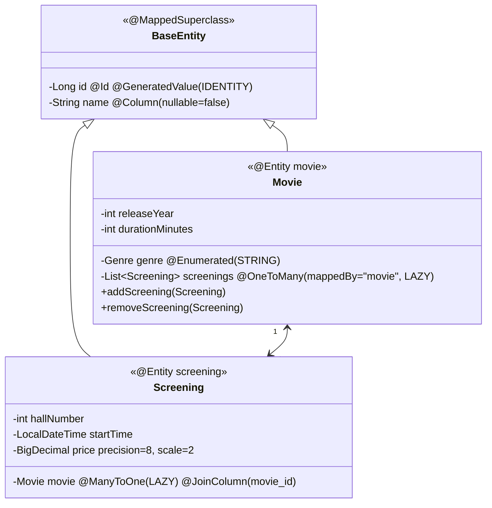

# Cinema-salesperson-s-workplace

Предметна область: **робоче місце касира кінотеатру**.

## Лабораторна робота №11 — робота з БД через Hibernate ORM (Jakarta Persistence)

Третя реалізація тих самих інтерфейсів `CRUDService<T>`, `MovieService`, `ScreeningService` (ЛР №7 — колекції, ЛР №10 — JDBC). Клієнтський код `ServiceDemo` не змінюється: `App` запускає його з `InMemoryMovieService`, а потім з `HibernateMovieService` — результат однаковий. Схему БД, як і раніше, створює `init.sql`; Hibernate її лише **перевіряє** (`hbm2ddl.auto=validate`).

### Сутності та зв'язок

Таблиці — з ЛР №10 (`init.sql` без змін): `movie(id, name, release_year, duration_minutes, genre)` і `screening(id, name, movie_id → movie.id, hall_number, start_time, price)`.

### Запуск з нуля
Потрібна лише **JDK 25+**; Maven Wrapper сам завантажить Maven, H2 працює у файловому режимі (`data/cinema.mv.db`).
```bash
cd lr11
./mvnw compile exec:java
```
Windows: `mvnw.cmd compile exec:java` (якщо кирилиця ламається — `chcp 65001`). Порожня БД: видаліть папку `data/` або запустіть
```bash
./mvnw exec:java -Dexec.args="reset"
```
Параметри БД — `src/main/resources/application.properties` (перекриваються змінними `DB_URL`, `DB_USER`, `DB_PASSWORD`).

### Структура
```
src/main/
├── resources/
│   ├── META-INF/persistence.xml   persistence-unit "cinema", validate, show_sql, format_sql
│   ├── application.properties     параметри БД
│   ├── init.sql                   схема з ЛР №10
│   └── simplelogger.properties    рівень логування slf4j-simple
└── java/ua/cinema/
    ├── App.java, ServiceDemo.java
    ├── model/       BaseEntity (@MappedSuperclass), Movie, Screening (@Entity), Genre
    ├── service/     інтерфейси з ЛР №7
    ├── memory/      реалізація в пам'яті
    ├── jdbc/        DBConnection (пул HikariCP), DbInitializer (init.sql) — з ЛР №10
    └── hibernate/   JpaUtil, AbstractHibernateCrudService, HibernateMovieService,
                     HibernateScreeningService, HibernateProblemsDemo, broken/BrokenMovie
```

### Де що реалізовано
| Вимога | Де |
|--------|----|
| `hibernate-core` 7.4.15.Final, `slf4j-simple`, драйвер H2 — версії зафіксовано | `pom.xml` |
| `persistence.xml`, `show_sql`, `format_sql`, `validate` | `META-INF/persistence.xml` |
| `JpaUtil` (Singleton, EMF один раз, EM на операцію, `inTransaction` / `read`) | `hibernate/JpaUtil.java` |
| Анотації, конструктор без параметрів, не `final`, `nullable/length/precision/scale`, `@Enumerated(STRING)`, `equals/hashCode` | `model/*` |
| `HibernateMovieService implements MovieService`, `EntityNotFoundException` | `hibernate/HibernateMovieService.java`, `AbstractHibernateCrudService` |
| Повний цикл create/read/update/delete | `ServiceDemo`, розділи 1–4 |
| Помилка `validate` при розбіжності `@Column` | `BrokenMovie` + `HibernateProblemsDemo.schemaValidation` |
| `@ManyToOne` + `@OneToMany(mappedBy)`, LAZY, `addScreening/removeScreening`, cascade, orphanRemoval | `Movie`, `Screening`, демо A, G |
| `@MappedSuperclass BaseEntity` | `model/BaseEntity.java` |
| JPQL: `ORDER BY`, `findByGenre`, пагінація, іменовані параметри | `HibernateMovieService`, `AbstractHibernateCrudService.findPage`, демо B, C |
| `LazyInitializationException` → JOIN FETCH | демо D |
| N+1 → JOIN FETCH, кількість SQL | демо E |

---

## Пояснення

### Що з JDBC-коду більше не пишеться вручну
SQL для `INSERT/UPDATE/DELETE/SELECT by id`, `mapRow(ResultSet)`, `setParameters(PreparedStatement)`, `RETURN_GENERATED_KEYS`, ручне `setAutoCommit/commit/rollback` у кожному методі, закриття `ResultSet/Statement`. Тепер це — анотації на класах, `em.persist/merge/find/remove` і JPQL за **полями класу** (`m.releaseYear`), а не колонками.

**Об'єктно-реляційна неузгодженість** на нашому прикладі: у Java фільм *містить* список сеансів (`movie.getScreenings()`), а в БД навпаки — сеанс *містить* `movie_id`, і списку в таблиці `movie` немає. Ще приклади: успадкування `BaseEntity` (у реляційній моделі його немає), рівність об'єктів (`==` / `equals`) проти рівності первинних ключів, `enum Genre` проти `VARCHAR`.

### `persistence.xml` і `JpaUtil`
`META-INF/persistence.xml` — стандартне місце, де провайдер JPA шукає конфігурацію в classpath (`Persistence.createEntityManagerFactory("cinema")` знаходить юніт за ім'ям). Перелічено класи сутностей і `exclude-unlisted-classes=true`, щоб навмисно хибний `BrokenMovie` не потрапив у основний юніт. З'єднання `JpaUtil` передає готовим `DataSource` (пул HikariCP із ЛР №10) через `jakarta.persistence.nonJtaDataSource`, тож параметри БД, як і раніше, лише в `application.properties`.

| | `EntityManagerFactory` | `EntityManager` |
|--|------------------------|-----------------|
| Скільки | один на застосунок (Singleton `JpaUtil`) | один на операцію |
| Вартість створення | дорога: метамодель, перевірка схеми, пул | дешева |
| Потокобезпечність | так | ні |
| Що тримає | конфігурацію, кеш 2-го рівня, статистику | контекст персистентності (кеш 1-го рівня), транзакцію |

`inTransaction(work)`: `begin` → робота → `commit`, при винятку `rollback`, у `finally` — `close`. `read(work)` — без транзакції, EM закривається try-with-resources. Усі сутності, що повертають сервіси, — **detached**.

### `hbm2ddl.auto`
| Значення | Що робить |
|----------|-----------|
| `none` | нічого |
| `validate` ✔ | перевіряє, що таблиці/колонки для сутностей існують і мають сумісні типи; не змінює БД |
| `update` | додає відсутні таблиці/колонки (нічого не видаляє, не змінює типи) |
| `create` | видаляє й створює схему при старті |
| `create-drop` | як `create`, і видаляє схему при закритті EMF |

`validate` — бо схема належить `init.sql` (обмеження `CHECK`, `UNIQUE`, `ON DELETE RESTRICT`, колація, індекси), і Hibernate не повинен її змінювати. `update`/`create` у справжній БД небезпечні: можуть втратити дані або згенерувати схему без наших обмежень.

**Демонстрація помилки.** `BrokenMovie` відображає ту саму таблицю `movie`, але має `@Column(name = "duration")` замість `duration_minutes`. Під час запуску окремої програмної конфігурації з цим класом (`HibernateProblemsDemo.schemaValidation`) Hibernate відмовляється стартувати:
```
SchemaManagementException: Schema validation: missing column [duration] in table [movie]
```
Те саме станеться, якщо в `Movie` змінити будь-який `@Column(name=...)`. **Не все** `validate` виявляє: зміну `length`, `nullable`, `precision/scale`, відсутні `UNIQUE`/`CHECK`/індекси він не перевіряє — лише наявність колонок і сумісність типів.

**Діалект** перекладає HQL/JPQL і типи Java на SQL конкретної СУБД (`LIMIT/OFFSET` чи `FETCH FIRST`, `IDENTITY` чи `SEQUENCE`, назви типів). Сучасний Hibernate визначає його сам за метаданими JDBC-з'єднання — у лозі видно `Database dialect: H2Dialect`, тому явно не вказуємо.

### Вимоги до сутностей і рішення
- `@Entity`, конструктор без параметрів (`protected` — для Hibernate, не для клієнтів), клас і методи **не `final`** (Hibernate створює підклас-проксі для LAZY), `@Id`.
- **`@GeneratedValue(strategy = IDENTITY)`** — бо в `init.sql` колонка `GENERATED BY DEFAULT AS IDENTITY`. `SEQUENCE` ефективніший (Hibernate бере id наперед, вміє пакетний INSERT), але потребує послідовності в схемі; `UUID` — глобально унікальний ключ без звернення до БД, але 16 байт і невпорядкований індекс; `AUTO` — вибір лишається за Hibernate (для H2 — `SEQUENCE`, і `validate` впав би: послідовності немає). Наслідок `IDENTITY`: INSERT виконується одразу при `persist` (щоб отримати id) і не пакетується.
- **`@Enumerated(EnumType.STRING)`**: у колонці `genre` — `'SCI_FI'`. З `ORDINAL` зберігалось би число (позиція в enum): вставили новий жанр у середину або змінили порядок — і всі наявні записи тихо стали іншими жанрами.
- **`nullable`, `length`, `precision`, `scale`** відповідають `init.sql` (`VARCHAR(200)`, `NUMERIC(8,2)`, `NOT NULL`). Коли схему створює `init.sql`, ці параметри використовує не БД, а документація коду, Hibernate при генерації DDL (`create`) і Bean Validation — вони мають збігатися зі схемою, щоб `create` в тестах дав ту саму схему.
- Довжина `name` різна (200 у фільму, 100 у сеансу), а поле одне в `BaseEntity` — тому `@AttributeOverride` у кожній сутності.
- **`@Transient`**: `Movie.highlighted` («показати у вітрині сьогодні») — стан інтерфейсу касира, у БД не зберігається.
- **`@MappedSuperclass`** — спільні поля й анотації `id/name` без окремої таблиці і без поліморфних запитів. `@Entity` з наслідуванням (`@Inheritance`) доречний, коли потрібні запити по всій ієрархії: `SINGLE_TABLE` — одна таблиця з колонкою-дискримінатором (швидко, але багато NULL; ієрархія квитків 2D/3D/IMAX з ЛР №6 — ідеальний кандидат); `JOINED` — таблиця на кожен клас, з'єднання JOIN (нормалізовано, повільніше); `TABLE_PER_CLASS` — повна таблиця на кожен конкретний клас (поліморфні запити через UNION).

### `equals` і `hashCode`
Рівність — за **первинним ключем**: два об'єкти рівні, якщо це той самий рядок таблиці. Нюанси:
- нова сутність (`id == null`) дорівнює лише сама собі — інакше всі нові фільми були б «рівні»;
- `hashCode` — константа класу, а не хеш id: id з'являється лише після `persist`, і об'єкт, покладений у `HashSet` до збереження, інакше «загубився» б;
- клас порівнюється з урахуванням `HibernateProxy`, а id читається через `getId()` — у LAZY-проксі поля порожні;
- рівність за всіма полями не годиться: сутність змінюється (оновлення ціни), і це не робить її іншою.

### Зв'язок «один до багатьох»
- **Власник зв'язку** — `Screening.movie` (`@ManyToOne` + `@JoinColumn(name = "movie_id")`), бо зовнішній ключ фізично лежить у таблиці `screening`. Hibernate записує `movie_id` **лише** за значенням цього поля. `Movie.screenings` — зворотна сторона (`mappedBy = "movie"` = «відображено полем `movie` в `Screening`»), окремої колонки чи таблиці для неї немає.
- Якщо додати сеанс лише в `movie.getScreenings()`, не встановивши `screening.movie`, у БД нічого не з'явиться (або `movie_id = NULL` → порушення `NOT NULL`). Тому колекція назовні лише для читання, `setMovie` — package-private, а змінювати зв'язок можна тільки через **`addScreening/removeScreening`**, які оновлюють обидві сторони.
- **LAZY** для обох сторін. `@OneToMany` і так LAZY за замовчуванням, а `@ManyToOne` — EAGER, тому вказано явно: інакше кожне читання сеансу тягнуло б фільм.
- **`cascade = {PERSIST, MERGE}`** на `Movie.screenings`: сеанс, доданий через `addScreening`, зберігається разом із фільмом без `em.persist(screening)` (демо A).
- **`orphanRemoval = true`**: сеанс без фільму не має сенсу (`movie_id NOT NULL`), тож прибраний з колекції сеанс видаляється з БД (`removeScreening`, демо G). Відмінність від `CascadeType.REMOVE`: `REMOVE` видаляє дітей лише разом із батьком, а `orphanRemoval` — ще й тоді, коли дитину просто від'єднали від батька.
- **`REMOVE` не вказано**, і `HibernateMovieService.beforeDelete` забороняє видаляти фільм із сеансами — та сама бізнес-логіка, що `ON DELETE RESTRICT` у ЛР №10 (демо F): розклад не має зникати мовчки. На стороні `@ManyToOne` `REMOVE` небезпечний взагалі: видалення одного сеансу видалило б фільм, а з ним — FK-помилка або (з каскадом) усі інші сеанси.
- **`toString()`** включає лише id фільму, а `Movie.toString()` — без сеансів: інакше `Movie → Screening → Movie → …` дає `StackOverflowError`, а на detached-об'єкті — `LazyInitializationException` при простому логуванні.
- `@ManyToMany` доречний, коли обидві сторони мають багато одна одної (фільм ↔ актори); у схемі це **проміжна таблиця** `movie_actor(movie_id, actor_id)` з двома FK.

### JPQL
Усі запити — з **іменованими параметрами**, без склеювання значень:
```java
em.createQuery("SELECT m FROM Movie m WHERE m.genre = :genre ORDER BY m.name, m.releaseYear", Movie.class)
  .setParameter("genre", genre)
```
- `findAllSortedByNameAndByReleaseYear()` — `ORDER BY m.name, m.releaseYear`;
- `findByGenre(Genre)`, `findByName(String)` (рядок `' OR '1'='1` → 0 записів, демо C), `ScreeningService.findByMovieId` — `WHERE s.movie.id = :movieId`;
- `findPage(page, size)` — `setFirstResult(page * size).setMaxResults(size)` → `OFFSET ? ROWS FETCH FIRST ? ROWS ONLY` у SQL (демо B).

Ім'я сутності в загальному `AbstractHibernateCrudService` підставляється з `Class.getSimpleName()` — це константа коду, не введення користувача.

### `LazyInitializationException` (демо D)
```java
Movie m = movies.findById(id);     // EntityManager закрито всередині findById
m.getScreenings().size();          // LazyInitializationException: ... Movie.screenings ... (no session)
```
Колекція LAZY — це «порожня обгортка», яка вміє завантажитися лише через відкритий `EntityManager`. Після його закриття ходити в БД нікому.

**Виправлення** — завантажити потрібне, поки сесія відкрита: `findByIdWithScreenings` → `SELECT m FROM Movie m LEFT JOIN FETCH m.screenings WHERE m.id = :id`. Переводити зв'язки на `EAGER` не можна: сеанси (а з ними й усе, що пов'язане з сеансами) тягнулися б **завжди**, навіть коли потрібна лише назва фільму, а для списків це прямо породжує N+1. Анти-патерни на кшталт `enable_lazy_load_no_trans` / Open Session in View лише ховають проблему.

### Проблема N+1 (демо E)
**До:** `SELECT m FROM Movie m`, потім у циклі `m.getScreenings().size()`. Hibernate виконує 1 запит за фільмами і ще **по одному запиту на кожен фільм**:
```sql
select m1_0.id, ... from movie m1_0 order by m1_0.name, m1_0.release_year      -- 1
select s1_0.movie_id, s1_0.id, ... from screening s1_0 where s1_0.movie_id=?  -- для Барбі
select s1_0.movie_id, s1_0.id, ... from screening s1_0 where s1_0.movie_id=?  -- для Дюна (1984)
...                                                                            -- ще N-2
```
**Після:** `SELECT DISTINCT m FROM Movie m LEFT JOIN FETCH m.screenings` — один SQL з `LEFT JOIN`.

Виміряно лічильником `Statistics.getPrepareStatementCount()` (4 фільми):

| | SQL-запитів |
|--|-------------|
| До (lazy-обхід у циклі) | **5** (1 + N, N = 4) |
| Після (`JOIN FETCH`) | **1** |

Зі 100 фільмами було б 101 проти 1.

**JOIN FETCH і пагінація.** JOIN по колекції множить рядки (фільм з 3 сеансами = 3 рядки), тож `LIMIT` в SQL обрізав би сеанси, а не фільми. Тому Hibernate при `setMaxResults` разом із fetch колекції завантажує **все** і пагінує в пам'яті (попередження `HHH90003004`) — на великій таблиці це катастрофа. Рішення: спершу сторінка id (`SELECT m.id ... ORDER BY ... LIMIT`), потім `JOIN FETCH ... WHERE m.id IN :ids`; або `@BatchSize` / `hibernate.default_batch_fetch_size`. Також не можна fetch-ити дві `List`-колекції одночасно (`MultipleBagFetchException`).

### H2 і інші СУБД
Проєкт працює на H2 у файловому режимі. При переході на PostgreSQL треба лише змінити драйвер і URL — JPQL і анотації ті самі, діалект Hibernate визначить сам. Розбіжності, які можуть проявитися: колація (`COLLATION=UKRAINIAN` у URL — специфіка H2; у PostgreSQL — `COLLATE "uk-UA-x-icu"`), синтаксис `IDENTITY`, точність `TIMESTAMP`, регістр імен у `validate`.
