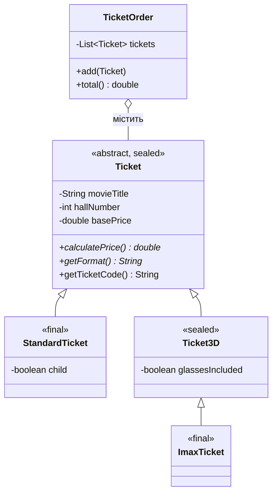

# Cinema-salesperson-s-workplace

Предметна область: **робоче місце касира кінотеатру**.

## Лабораторна робота №6 — ієрархія класів і наслідування

### Рефакторинг
У ЛР №1 тип сеансу визначався прапорцем і розгалуженням:
```java
boolean is3D = ...;
double surchargeAmount = is3D ? ticketCount * surcharge3D : 0.0;
```
Тепер кожен вид квитка — окремий клас зі своєю логікою ціни, а прапорця `is3D` більше немає.

### Діаграма класів


### Перевірка «is-a»
- 2D-квиток **є різновидом** квитка; 3D-квиток **є різновидом** квитка; IMAX-квиток **є різновидом** 3D-квитка.
- Замовлення **не є** списком квитків, воно **має** список → композиція (`TicketOrder`).

### Де що реалізовано
| Вимога | Реалізація |
|--------|------------|
| Базовий клас, спільні поля, `super(...)` | `Ticket`, конструктори підкласів |
| Поля `private` | `movieTitle`, `hallNumber`, `basePrice`: підкласи працюють через getter-и, базовий клас контролює інваріант «ціна > 0» |
| `@Override`, `toString()` через `super.toString()` | усі підкласи |
| Поліморфізм | масив `Ticket[]` у `lr6cinema.java`, розділ 2 |
| Абстрактний клас і метод | `Ticket`, `calculatePrice()`, `getFormat()` |
| 3 рівні, порядок конструкторів | `Ticket → Ticket3D → ImaxTicket`, розділ 1 |
| Делегування `this(...)` | `Ticket(String,int)`, `Ticket3D(...)`, `ImaxTicket(String,int)` |
| `final` | метод `getTicketCode()`, клас `ImaxTicket` |
| `instanceof` з pattern matching | розділ 3 |
| `equals`/`hashCode` | `Ticket`, `StandardTicket`, `Ticket3D`, розділ 5 + `EqualsDemo` |
| Композиція | `TicketOrder` |
| `sealed` + `switch` | `Ticket`, `Ticket3D`, метод `describe()` |

### Обґрунтування
- **Чому `calculatePrice()` абстрактний.** Ціна залежить від формату, «загальної» реалізації в базовому класі бути не може. Абстрактність змушує кожен підклас її реалізувати.
- **Порядок конструкторів** при `new ImaxTicket(...)`: спочатку `Ticket`, потім `Ticket3D`, потім `ImaxTicket` — підклас не може існувати раніше, ніж ініціалізована його базова частина (перший рядок конструктора — `super(...)`).
- **Чому `final`.** `getTicketCode()` — ідентифікатор квитка, правило формування однакове для всіх видів. `ImaxTicket` — найконкретніший вид, подальше уточнення не передбачене.
- **Статичний і динамічний тип.** У `Ticket t = new ImaxTicket(...)` статичний (оголошений) тип — `Ticket`: за ним компілятор вирішує, які методи можна викликати. Динамічний (фактичний) тип — `ImaxTicket`: за ним під час виконання вибирається, яка версія перевизначеного методу виконається. Специфічні методи (`isGlassesIncluded()`) доступні лише після перевірки `instanceof`.
- **`getClass()` чи `instanceof` в `equals`.** `instanceof` порушує симетрію, коли підклас додає поля: `base.equals(sub)` = true, а `sub.equals(base)` = false (показано в `EqualsDemo`). `getClass()` гарантує симетрію, але квитки різних класів ніколи не рівні — для квитків це правильно: 2D- і 3D-квиток не взаємозамінні.
- **Чому композиція для замовлення.** Якби `TicketOrder extends ArrayList<Ticket>`, зовні стали б доступні `clear()`, `remove()`, `sort()`, що ламають логіку замовлення; змінити структуру зберігання було б неможливо без зміни всіх клієнтів.
- **Що дає `sealed`.** Компілятор знає повний набір нащадків, тому `switch` без `default` перевіряється на повноту: додали новий дозволений підклас і забули обробити — помилка компіляції.

### Запуск (Java 25)
```bash
cd lr6
java lr6cinema.java
```
Усі `.java` файли мають лежати в одній папці.
