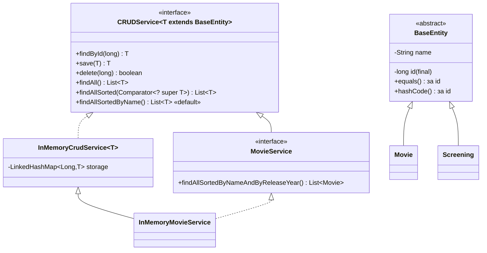

# Cinema-salesperson-s-workplace

Предметна область: **робоче місце касира кінотеатру**.

## Лабораторна робота №7–9 — типізований CRUD-сервіс: узагальнення, колекції, сортування

### Сутності
| Клас | Поля (крім `id`, `name` з `BaseEntity`) | Що означає `name` |
|------|-----------------------------------------|-------------------|
| `Movie` | `releaseYear`, `durationMinutes`, `genre` (`Genre`) | назва фільму |
| `Screening` | `movieId`, `hallNumber`, `startTime`, `price` (`BigDecimal`) | назва сеансу («Ранковий», «Вечірній») |

У `BaseEntity` винесено лише те, що потрібно **узагальненому сервісу**: `id` (ключ сховища) і `name` (сортування за іменем). Усе, що описує конкретний предмет (рік, зал, ціна), лишилося в підкласах — сервісу про це знати не треба.

### Діаграма


### Запуск (Java 25+)
```bash
cd lr7
java lr7cinema.java
```
Усі `.java` файли мають лежати в одній папці (multi-file source launcher). Якщо в консолі Windows «кракозябри»: `chcp 65001` перед запуском.

### Де що реалізовано
| Вимога | Де |
|--------|----|
| `BaseEntity` (id незмінний), `equals/hashCode` за id | `BaseEntity.java` |
| `EntityNotFoundException` з полем `id` | `EntityNotFoundException.java`, демо розділ 4 |
| `CRUDService<T extends BaseEntity>` | `CRUDService.java` |
| `InMemoryCrudService<T>` для обох сутностей | розділи 1–5 (`Movie`, `Screening`) |
| Оновлення без збільшення кількості, успішний/неуспішний `delete` | розділи 2, 3 |
| `findAllSortedByName()` — `default`-метод | `CRUDService`, розділи 7, 11 |
| `MovieService.findAllSortedByNameAndByReleaseYear()` | `MovieService`, `InMemoryMovieService`, розділ 8 |
| До/після сортування, сховище не змінюється | розділи 6–9 |
| `findAllSorted(Comparator<? super T>)` | `InMemoryCrudService`, розділ 11 |
| `printAll(Collection<? extends BaseEntity>)` | `EntityPrinter`, розділ 12 |
| `name == null` | `EntityComparators.BY_NAME` (`nullsLast`), розділ 14 |

---

## Обґрунтування рішень

### Чому `EntityNotFoundException` неперевірений (`RuntimeException`)
Пошук неіснуючого id — це помилка викликаючого коду (взяв id «звідкись не звідти»), а не нормальний сценарій, який треба обробляти в кожному місці. Якби виняток був перевіреним, кожен виклик `findById` (навіть усередині сервісу, де id щойно отримано з того ж сховища) потребував би `try/catch` або `throws`, а `default`-методи та лямбди (`ids.stream().map(service::findById)`) не компілювалися б без обгорток. Неперевірений виняток не засмічує сигнатуру, але все одно доступний для обробки там, де це має сенс (демо розділ 4). Так само роблять JPA (`jakarta.persistence.EntityNotFoundException`) і Spring.

### Чому `findById` кидає виняток, а `delete` повертає `boolean`
`findById` мусить повернути об'єкт; повернути «нічого» можна лише `null`, який потім вилетить `NullPointerException` далеко від місця помилки. `delete` нічого не повертає по суті, і «видаляти нічого» — нормальна ситуація (ідемпотентність: повторне видалення не є помилкою), тому достатньо `false`.

### Навіщо `T extends BaseEntity`
Усередині `InMemoryCrudService` викликається `entity.getId()` (ключ для `Map.put`), а в `findAllSortedByName()` — `getName()`. Без обмеження `T` стирається до `Object`, і ці виклики не компілюються: довелося б приводити типи `((BaseEntity) entity).getId()` з ризиком `ClassCastException` під час виконання. Також обмеження не дає створити безглуздий `CRUDService<String>`.

### `new T()` / `new T[10]` і внутрішнє сховище
Через стирання типів під час виконання `T` невідомий, тому `new T[]` неможливий. Сховище — `Map<Long, T>`, масив не потрібен. Ім'я типу для повідомлень винятку передається в конструктор (`"Movie"`). `CRUDService<long>` неможливий, бо параметр типу — лише посилальний тип; на практиці `Long` (автоупаковка) — ключ мапи `Map<Long, T>`.

### Вибір колекції для сховища: `LinkedHashMap<Long, T>`
| Колекція | `findById` | `save` (додати/оновити) | `delete` | відсортований список | Порядок обходу |
|----------|-----------|--------------------------|----------|-----------------------|----------------|
| `ArrayList<T>` | O(n) — лінійний пошук | O(n) — спершу знайти наявний id | O(n) — пошук + зсув | O(n log n) копія + sort | порядок додавання |
| `HashMap<Long,T>` | O(1) | O(1) `put` | O(1) | O(n log n) | **не гарантований** |
| `LinkedHashMap<Long,T>` ✔ | O(1) | O(1) `put` | O(1) | O(n log n) | порядок додавання |
| `TreeMap<Long,T>` | O(log n) | O(log n) | O(log n) | O(n) лише за id; за іменем — O(n log n) | за ключем (id) |

Обрано **`LinkedHashMap`**: усі CRUD-операції за id — O(1), як у `HashMap`, а `findAll()` повертає записи в передбачуваному порядку додавання (у `HashMap` порядок «випадковий» і змінюється при розширенні таблиці — незручно для демо й тестів). `TreeMap` впорядковує лише за ключем, а нам потрібно за іменем — виграшу немає, а операції повільніші. `ArrayList` — пошук за id лінійний.

Повторний `put` для наявного ключа в `LinkedHashMap` **не змінює** позицію запису (видно в розділі 9: оновлений `Аватар` лишився другим).

*Якби головною операцією був відсортований вивід* — можна тримати додатковий індекс `TreeMap<String, List<T>>` за іменем. *Якби записів були мільйони* — сховище в пам'яті не підходить, потрібна БД з індексами та `ORDER BY` + пагінація (ЛР №10).

Чому не `TreeSet<T>` з компаратором за іменем як основне сховище: `TreeSet` вважає елементи рівними, якщо `compare == 0`, тому другий фільм «Дюна» (1984) **не додався б зовсім** — `add` поверне `false`. Крім того, пошук за id в ньому лінійний.

### `save`: як розрізняються нова й наявна сутність
Через `Map.put(id, entity)`: він сам додає або замінює значення і **повертає попереднє** (`null` — якщо ключа не було). Два виклики з однаковим id → один запис, остання версія (розділ 2: було 7, стало 7). `save(null)` → `Objects.requireNonNull` кидає `NullPointerException` з повідомленням одразу, а не колись пізніше.

### Comparable чи Comparator → **Comparator**
- У сутностей **немає одного природного порядку**: фільми сортуємо за назвою, за назвою+роком, за тривалістю; сеанси — за назвою+часом. `Comparable` дає лише один порядок і «вшиває» його в клас.
- `compareTo` у `BaseEntity` за іменем був би **неузгоджений з `equals`** (за id) — такі об'єкти поводяться дивно в `TreeSet`/`TreeMap`. Компаратор — окремий об'єкт, і така неузгодженість стосується лише місця, де його явно використано.
- Порівняння рядків має враховувати мову: `Collator` для `uk_UA` ставить «Ї» після «Д» і перед «К» (розділ 7), тоді як `String.compareTo` порівнює коди Unicode. `Collator` — це вже `Comparator`, його зручно комбінувати через `Comparator.comparing(..., collator)`.
- Для другого порядку використано той самий підхід — `thenComparingInt(Movie::getReleaseYear)`. Поруч є ручний компаратор `MOVIE_BY_NAME_AND_YEAR_MANUAL` (розділ 10 перевіряє, що результати однакові):

```java
// через thenComparing
Comparator<Movie> c1 = EntityComparators.<Movie>byName().thenComparingInt(Movie::getReleaseYear);

// вручну
Comparator<Movie> c2 = (a, b) -> {
    int byName = BY_NAME.compare(a, b);
    return byName != 0 ? byName : Integer.compare(a.getReleaseYear(), b.getReleaseYear());
};
```
`Integer.compare` / `BigDecimal.compareTo`, а не `a - b`: віднімання переповнюється для великих чисел (`Integer.MIN_VALUE - 1` → додатне) і не працює з `double` (дробова різниця обрізається до 0).

### Вторинне поле: рік виходу
У кінотеатрі однакові назви — це **ремейки** («Дюна» 1984 і 2021, «Король Лев» 1994 і 2019). Касиру логічно бачити їх поруч і в хронологічному порядку (розділ 8: 1984 перед 2021, 1994 перед 2019). Для сеансів з однаковою назвою «Вечірній» вторинне поле — час початку.

### Узгодженість компаратора з `equals`
`equals` — за id, компаратор — за іменем. Вони **не узгоджені**: `a.equals(b) == true`, але `compare(a, b) != 0` (розділ 13), і навпаки — два різні фільми «Дюна» мають `compare == 0`, але не рівні. Наслідок: такий компаратор можна використовувати для сортування списків, але **не** для `TreeSet`/`TreeMap` (втрата записів, див. вище). Сортування `List.sort` стабільне, тому при `compare == 0` зберігається порядок сховища.

### Чому `findAllSortedByNameAndByReleaseYear()` — в `MovieService`, а не в `CRUDService<T>`
Поле `releaseYear` є лише в `Movie`. У загальному інтерфейсі такий метод означав би, що `CRUDService<Screening>` теж мусить сортувати «за роком», якого в сеансу немає. Тому специфічні операції винесено в інтерфейс конкретної сутності `MovieService extends CRUDService<Movie>`, а реалізація `InMemoryMovieService extends InMemoryCrudService<Movie>` успадковує всю CRUD-логіку і додає один метод. Окремий **інтерфейс** (а не лише клас) потрібен, щоб клієнтський код залежав від контракту: у ЛР №10 з'явиться `JdbcMovieService implements MovieService`, і демо не зміниться.

### `findAllSorted(Comparator<? super T>)` — чому `? super T`
Компаратор лише **споживає** елементи (принцип PECS: *Producer Extends, Consumer Super*). Компаратор для батьківського типу вміє порівнювати й нащадків: `Comparator<BaseEntity> BY_NAME` можна передати і в `CRUDService<Movie>`, і в `CRUDService<Screening>`. З параметром `Comparator<T>` виклик `findAllSorted(BY_NAME)` у `default`-методі не скомпілювався б — довелося б писати окремий компаратор за іменем для кожної сутності.

### `printAll(Collection<? extends BaseEntity>)` — чому wildcard
Generics **інваріантні**: `List<Movie>` не є підтипом `List<BaseEntity>`. Якби було можна, то в метод, що приймає `List<BaseEntity>`, хтось додав би `Screening` — і в списку фільмів опинився б сеанс. `? extends BaseEntity` означає «список якогось нащадка BaseEntity»: читати елементи як `BaseEntity` безпечно, а додавати (крім `null`) компілятор не дозволить. Тому `printAll` приймає і `List<Movie>`, і `List<BaseEntity>` (розділ 12).

### Як перевірено, що сортування не змінює сховище
Методи сортування копіюють значення в новий `ArrayList` і сортують копію. Розділи 6 і 9 виводять `findAll()` до й після сортувань — порядок і кількість однакові.

### Що змінити, щоб додати третю сутність (наприклад, `Hall`)
Лише створити `class Hall extends BaseEntity` і `new InMemoryCrudService<Hall>("Hall")`. Якщо потрібне специфічне сортування — `HallService` + `InMemoryHallService`. `BaseEntity`, `CRUDService`, `InMemoryCrudService`, `EntityPrinter`, `EntityComparators.BY_NAME` залишаються без змін.

### `List.of(...)` vs `new ArrayList<>(...)`
`List.of` — незмінний список (`add`/`sort` → `UnsupportedOperationException`, `null` заборонено). У розділі 14 список, який сортується, обгорнуто в `new ArrayList<>(List.of(...))`. Видаляти елементи в for-each не можна (`ConcurrentModificationException`) — для цього `Iterator.remove()` або `removeIf`.
